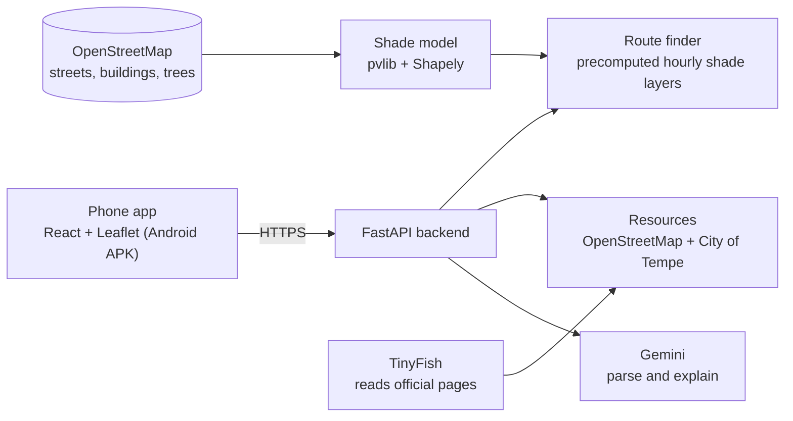

# Cool Route

**Google Maps finds the fastest way to walk. We find the coolest.**

Built by Sparky's (Shreyas, Rohan, Shravani, Bhavisha) at SunHacks 2026, Arizona State University.

Cool Route is a mobile-first app (Android APK plus web) that finds the lowest-sun
walking route across ASU Tempe and Mill Ave, shows it next to the fastest route,
and finds the nearest water or cooling spot.

## Problem

Extreme heat is a leading cause of weather-related death in Arizona, and most of
it happens outdoors. Maricopa County recorded 430 heat-related deaths in 2025,
including 18 in Tempe ([City of Tempe heat relief page](https://www.tempe.gov/government/community-health-and-human-services/housing-services/ending-homelessness/heat-relief)).
In mid-August 2026, about 68% of that season's heat deaths in the county had
happened outdoors (City of Phoenix weekly heat response report; preliminary figure).

Navigation apps default to the shortest route. They do not know which streets
have shade, and they treat a sunny mile at 3 PM the same as the same mile at night.

## What it does

- **Cool Route:** fastest and coolest routes side by side, with shade %, walking
  time, and minutes spent in direct sun. A slider blends speed and shade.
- **Plain English:** type "3 PM, avoid stairs" and Gemini fills in the settings,
  then writes a short explanation of the route using only numbers from the result.
- **Help now:** the nearest water points, libraries and City of Tempe heat-relief
  sites, each marked open, closed or **hours unknown**. We never guess hours.
- **Sign-in and onboarding** (demo mode, see below): a branded intro video, then Google or phone sign-in, your name, and what brings you here. Guests can skip it. Your details and preferences are saved on the phone only; there is no account server and no database.

## Example result (real model output)

Memorial Union to Tempe Beach Park, leaving at 3:00 PM:

| | Distance | Walk | Shade | Time in sun |
|---|---|---|---|---|
| Fastest | 2,161 m | 26.7 min | 7% | 24.8 min |
| Coolest | 2,243 m | 27.7 min | 38% | 17.2 min |

That is 7.6 minutes (31%) less direct sun for about a minute more walking. The
benefit depends on the trip and the hour: the same trip at noon saves 15%, and a
short trip from the Student Pavilion to Mill Ave saves 9%. When the coolest route
is not meaningfully cooler, the app says so.

## Scope and honesty

- Shade is an **estimate from map data** (building shadows from sun position,
  OpenStreetMap trees, covered walkways). It is not a measurement and we do not
  measure temperature. Most buildings in OpenStreetMap lack height data, so many
  shadows rest on default heights. Shade layers are computed for a mid-July day.
- Covered walkways are limited to those tagged in OpenStreetMap plus a few we
  labelled by hand.
- Coverage is the ASU Tempe campus and Mill Ave (about 2 km x 2 km). Points outside
  it are rejected with a clear message.
- The City of Tempe heat-relief sites are listed as open May 1 to Sept 30, so
  outside that season the app shows "hours unknown". OpenStreetMap hours are
  labelled "not verified".
- Cool Route lowers sun exposure on a walk. It does not address indoor heat deaths
  or homelessness. It is aimed at pedestrians, older adults, students and outdoor
  workers. The app gives general information, not medical advice.

## Sign-in is a demo

The sign-in screens (Google, and phone with a 6-digit code) are a complete, working
flow, but they run in **demo mode**: no Google account is checked and no text message
is sent, and the screens say so. The demo code is `123456`. Nothing is verified, and
nothing leaves the phone. Guests can skip sign-in. To make it real, replace the three
functions in `frontend/src/auth/demoAuth.ts` with a real provider (for example
Firebase Authentication with phone sign-in and native Google sign-in) and set
`AUTH_LIVE` to `true`; the screens do not change. Real Google sign-in does not work
inside a plain Android web view, so it needs a native plugin and your own credentials.

## How it works



1. **Shade model (offline).** OSMnx downloads the walking network, buildings and
   trees. pvlib gives the sun position for each hour from 06:00 to 19:00, Shapely
   projects building shadows, and each street segment gets a shade fraction.
2. **Route finder.** A shortest-path search where each segment costs distance plus a
   penalty for sun exposure. The slider and heat sensitivity change the penalty.
3. **Resources.** OpenStreetMap water and libraries, plus six City of Tempe
   heat-relief sites with structured hours. TinyFish reads the official page and a
   refresh script marks a listing stale if the page no longer matches, so the API
   reports hours as unknown instead of guessing.
4. **Gemini.** Turns free text into route settings with structured output and
   re-validates every field. It writes the explanation, and code rejects any reply
   that cites a number not in the route result, is cut off, or copies field names;
   those fall back to fixed wording. Keys stay on the server.

## Tech stack

| Layer | Tools |
|---|---|
| App | React, TypeScript, Vite, Tailwind, Leaflet, Capacitor (Android) |
| Backend | Python 3.12, FastAPI, Pydantic |
| Map and shade | OpenStreetMap, OSMnx, NetworkX, Shapely, pvlib |
| AI and live data | Gemini API, TinyFish (Fetch) |
| Cloud | AWS Lambda with a Function URL (the same FastAPI app via Mangum) |
| Planning and tooling | Kiro (architecture spec), GitHub pull requests |

## Run it

Requirements: Python 3.12, Node 20+. Use three terminals, each starting at the repo root.

macOS / Linux:

```bash
# Terminal 1: API
python3.12 -m venv .venv && source .venv/bin/activate
pip install -r backend/requirements.txt
cp .env.example .env            # add your own GEMINI_API_KEY, GEMINI_MODEL, TINYFISH_API_KEY
uvicorn backend.api.main:app --port 8000

# Terminal 2: app, then open http://localhost:5173
cd frontend && npm install && cp .env.example .env.local && npm run dev

# Terminal 3: tests
source .venv/bin/activate && pytest backend/tests
```

Windows (PowerShell, one command per line):

```powershell
# Terminal 1: API
py -3.12 -m venv .venv
Set-ExecutionPolicy -Scope CurrentUser RemoteSigned   # once, if activate says scripts are disabled
.venv\Scripts\activate
pip install -r backend/requirements.txt
cp .env.example .env            # add your own GEMINI_API_KEY, GEMINI_MODEL, TINYFISH_API_KEY
uvicorn backend.api.main:app --port 8000

# Terminal 2: app, then open http://localhost:5173
cd frontend
npm install
cp .env.example .env.local
npm run dev

# Terminal 3: tests
.venv\Scripts\activate
pytest backend/tests
```

API reference: http://localhost:8000/docs and [docs/API_CONTRACT.md](docs/API_CONTRACT.md).

Rebuild the data (optional, the repo includes it):

```bash
pip install -r backend/requirements-geo.txt
python -m backend.shade.fetch_osm && python -m backend.shade.build_shade
python scripts/fetch_osm_resources.py
python scripts/refresh_resources.py          # needs TINYFISH_API_KEY
```

Deploy the API to AWS Lambda (Python 3.12, x86_64): build the package, upload it, set
the handler to `backend.lambda_handler.handler`, and add `GEMINI_API_KEY`,
`GEMINI_MODEL` and `TINYFISH_API_KEY` as environment variables in the Lambda console.
Enable a Function URL with auth type NONE (CORS is handled by the app).

```bash
PATH="$PWD/.venv/bin:$PATH" bash scripts/build_lambda.sh   # writes dist/coolroute-lambda.zip (about 12 MB)
```

Android APK: the app runs from `https://localhost` inside the APK, so the API must be
reachable over HTTPS (the Lambda Function URL works).

```bash
cd mobile && VITE_API_URL=https://your-api-address.example npm run apk
# APK: mobile/android/app/build/outputs/apk/debug/app-debug.apk
```

## Demo

Screen recording and photos: [Google Drive](https://drive.google.com/file/d/1jvZ-wFS8XuNwV_o_2fhHs7JaszeOq6_r/view?usp=sharing). The click-by-click walkthrough is in [docs/DEMO_SCRIPT.md](docs/DEMO_SCRIPT.md).

## Team

| Person | Built |
|---|---|
| Shreyas | API and shared contract, resources and live hours, Android app, integration |
| Rohan | Shade model and route finder |
| Bhavisha | Mobile interface: route form, map, comparison, Help now, saved preferences |
| Shravani | Gemini request parsing and route explanations, with tests |

Architecture spec drafted with Kiro. Details: [docs/ARCHITECTURE.md](docs/ARCHITECTURE.md).

## Future improvements

- More accurate shade: building heights, tree canopy data, more hand-labelled covered
  walkways, and shade layers by season.
- Wider coverage than the ASU Tempe corridor.
- A hosted web version of the app (S3 and CloudFront), so it can be opened without
  installing the APK, and a persistent store for usage-based rate limits (today they
  are in memory per Lambda container).
- Live temperature and UV from a weather service, and verified hours for more sites.
- Spanish and other languages.
